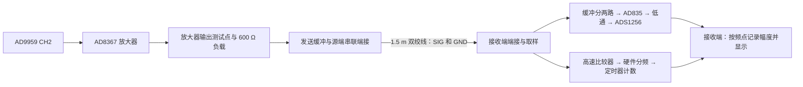

# 2017H 双绞线接线与验收

## 接哪一段

原题发挥部分（2）要求用一条 1.5 m 双绞线连接发送端与幅频测试装置，一根传信号，一根接地。接收端要得到频率和放大器输出幅度，并在示波器上显示幅频曲线。见项目资料《远程幅频特性测试装置（H 题）》第 2 页图 2。

选同一对网线芯，例如蓝线接 `SIG`，白蓝线接 `GND`。两端用相同颜色，其他芯线两端都悬空。保持绞合到靠近接头，不要长距离拆开。只传模拟波形，不接网口，不用其他芯线送频率、时钟或电源。接收端使用本地电源。

## 端接与分路

- 发送端：保留放大器的输出测试点和 600 Ω 测试负载。高输入阻抗的宽带缓冲从测试点取样，由缓冲器驱动双绞线。避免把线缆端接直接并到 600 Ω 负载上。最终在 1 MHz～40 MHz 核对加装缓冲前后的测试点幅度。
- 接收端：选标称 100 Ω 的 Cat5e 线对，可先用 100 Ω 电阻跨接 `SIG` 和 `GND`，位置靠近线端。发送缓冲的输出阻抗与串联电阻之和，以接近线对特性阻抗为起点。如果发送缓冲带直流偏置，先隔直，再送入线缆，并核对隔直网络在 1 MHz 的损耗。100 Ω 是传输端接的起点，不是放大器的测试负载。
- 幅度支路：从端接点高阻取样，用缓冲后的两路同相信号分别驱动 AD835 的 `INPUT1` 和 `INPUT2`。不要把两个未经核实阻抗的 SMA 输入口直接并到端接点。AD835 输出口须保留平方结果的直流分量。经低通后确认电压范围，再接 ADS1256 模块端子 `AIN1`（芯片通道 `0`）。现有 `OUTPUT2` 尚未确认能传直流，不能作为施工前提。
- 频率支路：也从端接点高阻取样。高速比较器把正弦变成逻辑脉冲。比较器用中点偏置和少量迟滞，避免在近零幅度时反复触发。候选为 3.3 V 供电的 `TLV3501`。要实测最小幅度、40 MHz 下的脉冲质量。比较器的阈值、输入范围和输出逻辑电平都要核对，不能把线上的模拟信号直接接 STM32 引脚。

## 接收端测频与配对

线上只传放大器输出的正弦波。频率包含在波形的周期里，不另发数字报文。接收端从比较器脉冲独立测频，不读发送端扫频索引，也不按点号猜频点。载波太弱、失真或丢失时标为无效点，不沿用上一次的频率。最后验收用独立接收控制器，同一块板可以先做台架验证。

现工程 `.ioc` 的 `Tim2OutputFreq_Value` 是 64 MHz，不假设定时器能直接可靠数到 40 MHz。首版可用两级 D 触发器组成 ÷4，把 1 MHz～40 MHz 变为 250 kHz～10 MHz。候选为 3.3 V 的双 D 触发器 `SN74LVC74A`。选接收板能引出的定时器输入脚，核对复用映射、计数时钟和输入滤波设置。用硬件定时器计边沿，不用每边沿中断。

门宽若为 1 ms，频率等于 `计数 × 4,000 Hz`：1 MHz、20 MHz、40 MHz 对应 250、5,000、10,000 个脉冲。1 个计数对应 4 kHz，这只是量化步距，不是整机测频精度。连续两个计数窗口落在同一频点并接近整 MHz，才开始等待低通稳定。采一批新 ADC 样本后再检查频点，采样中切频就丢弃整批。发送端每点驻留时间要覆盖判频、实际低通稳定时间和采样时间。

## 验收次序

1. 在短连接上读出可重复的平方检波响应，再核对 ADC 参考电压和输入量程。先解决 `OUTPUT1` 和 `OUTPUT2` 的直流通路问题。
2. 单独验证 1、20、40 MHz 的测频。由发送端打乱频点顺序，接收端只靠双绞线取得频率和幅度信息。还要关掉载波，确认接收端报无效点。测试时不用串口、SWD 或其他线给接收端提供频率。
3. 保持端接、分路和探测点不变，比较短跳线与 1.5 m 双绞线。用已知幅度或仪表测得的幅度作逐频校准。补偿传输和接收误差，不能把被测 AD8367 的实际频响校平。
4. 输出 1 MHz～40 MHz、每 1 MHz 一个点的曲线。表中保留实测频率、ADC 原始码、换算幅度和无效原因。用示波器显示曲线，检查频点完整性，并保留信号源、放大器的测试点。

当前状态：完成方案，未搭建端接和测频电路，未烧录，未做双绞线实测。现场可先预备一段 1.5 m 的 Cat5e 同绞线对，保留现有短连接。

器件依据：TI《TLV350x》及《SN74LVC74A》数据手册。实际接线前核对所购封装的引脚表。
